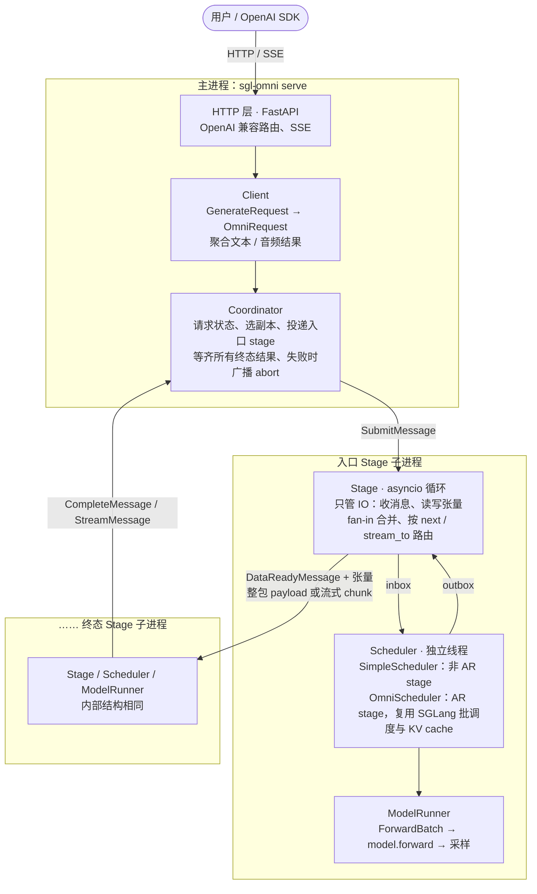
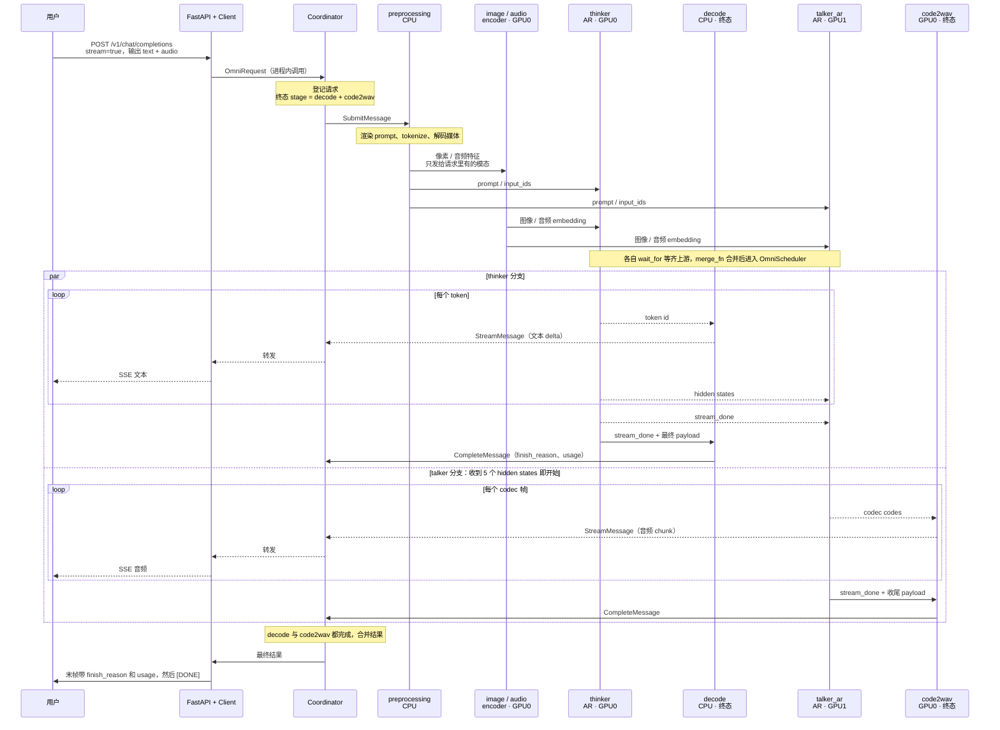

# SGLang-Omni 整体架构与请求流程

> 基于 `sgl-project/sglang-omni` main 分支 `4078cbcb` 整理。

SGLang-Omni 把一个 omni 模型拆成由若干 stage 组成的 DAG，比如预处理、编码器、thinker、talker、vocoder，每个 stage 跑在自己的进程里。主进程里的 Coordinator 管请求的整个生命周期。stage 之间的控制消息走 ZMQ，张量走 relay。

下面两张图：第一张是和具体模型无关的框架分层，第二张用 Qwen3-Omni（文本 + 语音输出）走一遍完整请求。

## 框架分层

- **拓扑是声明式的。** 每个模型在 `models/<model>/config.py` 里用 `StageConfig` 声明全部 stage：
  - `next` / `route_fn`：结果发给谁
  - `wait_for` + `merge_fn`：多路汇合
  - `stream_to`：流式边
  - `gpu` / `process`：放哪张卡、哪些 stage 共用一个进程

  YAML 和 CLI 只能改参数，不能增删 stage。
- **Stage 管 IO，Scheduler 管计算。** Stage 等上游数据到齐后把任务放进 `scheduler.inbox`。Scheduler 线程算完放回 `outbox`，再由 Stage 路由出去。Stage 不区分调度器类型：
  - 非 AR stage 用 `SimpleScheduler` 或专用的流式调度器。
  - AR stage（thinker、talker）用 `OmniScheduler`，复用 SGLang 的批调度、prefill/decode 和 KV cache。
- **传输方式自动选择，不需要配置。** 控制消息一律走 ZMQ。张量由 `CommRouter` 按两端位置选：
  - 同进程：直接传 Python 对象
  - 同机 GPU 之间：CUDA IPC
  - CPU 数据：SHM
  - 跨机：Mooncake
- **启动顺序。**
  1. `sgl-omni serve` 合并模型默认配置、YAML 和 CLI。
  2. `MultiProcessPipelineRunner` 规划 GPU 放置、进程分组和 ZMQ 端点，然后启动 Coordinator。
  3. 分批拉起各 stage 子进程。
  4. 子进程全部 ready 后，主进程再创建 Client 和 FastAPI。

  TP stage 每个 rank 一个进程，只有 rank 0 对外收发。

## 一次请求的交互（Qwen3-Omni，文本 + 语音，流式）

以默认的 `Qwen3OmniSpeechPipelineConfig` 为例：7 个 stage 各占一个进程，thinker 在 GPU0，talker 在 GPU1。实线是整包 payload 或控制消息，虚线是流式 chunk。

- **先扇出，再各自汇合。** preprocessing 只把数据发给请求里实际带的模态对应的 encoder，并用 `project_payload` 给每个下游裁剪字段。thinker 和 talker 各自等上游到齐后再合并。
- **文本和语音并行输出。** thinker 每出一个 token，就把 token id 推给 decode，同时把 hidden states 推给 talker。默认配置下 talker 收到 5 个 chunk 就开始生成（partial start），不等 thinker 结束，所以文本还在生成时音频已经开始流出。
- **两个终态 stage。** 语音请求要等 decode 和 code2wav 都完成，Coordinator 才合并结果；只要文本的请求只走到 decode。任何 stage 失败或请求被取消，Coordinator 都会广播 `AbortMessage`，所有 stage 清理这个请求。

## 代码阅读顺序

想顺着代码读，可以依次看 `sglang_omni/` 下的：

1. `serve/openai_api.py`
2. `client/client.py`
3. `pipeline/coordinator.py`
4. `pipeline/stage/runtime.py`
5. `scheduling/omni_scheduler.py`

模型侧从 `models/qwen3_omni/config.py` 和 `request_builders.py` 开始。
